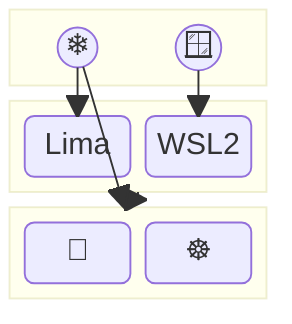

# dotfiles

[](https://github.com/kachick/dotfiles/actions/workflows/nix.yml?query=branch%3Amain+)
[](https://github.com/kachick/dotfiles/actions/workflows/windows.yml?query=branch%3Amain+)
[](https://github.com/kachick/dotfiles/actions/workflows/container.yml?query=branch%3Amain+)

Personal dotfiles that can be placed in the public repository\
Also known as [盆栽(bonsai)](https://en.wikipedia.org/wiki/Bonsai) 🌳



## For visitors

If you are using [Podman](https://podman.io/), you can test the pre-built [ubuntu container-image](containers) as follows.

```bash
bash <(curl -fsSL https://raw.githubusercontent.com/kachick/dotfiles/main/containers/sandbox-with-ghcr.bash) latest
```

Or, you can directly use some commands with `nix run` without any installation steps.

```bash
nix run 'github:kachick/dotfiles#todo'
```

List them

```bash
nix flake show 'github:kachick/dotfiles' --json 2>/dev/null | jq '.packages | ."x86_64-linux" | to_entries | map("\(.key) # \(.value.description)")'
```

## NixOS

List defined hostnames

```bash
nix eval --json 'github:kachick/dotfiles#nixosConfigurations' --apply 'builtins.attrNames' | jq '.[]'
```

Using flake style is disabled in NixOS by default and [you should inject git command to use flakes](https://www.reddit.com/r/NixOS/comments/18jyd0r/cleanest_way_to_run_git_commands_on_fresh_nixos/).

**NOTICE: This command might drop all existing users except those defined in the configurations.**

```bash
nix --extra-experimental-features 'nix-command flakes' shell 'github:NixOS/nixpkgs/nixos-26.05#gitMinimal' \
	--command sudo nixos-rebuild switch \
	--flake "github:kachick/dotfiles#$(hostname)" \
	--show-trace
```

Finally, reboot the device

```bash
sudo reboot now
```

Refer to the [sample](nixos/hosts/sample) flake for an example of inheriting modules from another repository.

## home-manager

List definitions

```bash
nix eval --json 'github:kachick/dotfiles#homeConfigurations' --apply 'builtins.attrNames' | jq '.[]'
```

## Ubuntu

1. Install and configure Nix:

   ```bash
   curl -fsSL https://raw.githubusercontent.com/kachick/dotfiles/main/scripts/install-nix.bash | bash
   ```

1. If you forgot to add something during the installation phase, manually add it.\
   Some configurations require a reboot to be applied, such as `trusted-users`.

1. Make sure there is a nix directory that is used in the home-manager.\
   This is a workaround, See [the thread](https://www.reddit.com/r/Nix/comments/1443k3o/comment/jr9ht5g/?utm_source=reddit&utm_medium=web2x&context=3) for details

   ```bash
   mkdir -p ~/.local/state/nix/profiles
   ```

1. Restart current shell to load Nix as a PATH

   ```bash
   bash
   ```

1. Apply dotfiles

   ```bash
   NIX_CONFIG='accept-flake-config = true' nix run 'github:kachick/dotfiles#home-manager' -- switch -b backup --flake 'github:kachick/dotfiles#user@wsl-ubuntu'
   ```

1. Apply system level dotfiles with [sudo for nix command](https://github.com/kachick/dotfiles/commit/2e47c6655dc74a4a56495fdcbebb9d15b0b57313)

   ```bash
   sudoc nix run 'github:kachick/dotfiles#apply-system'
   ```

1. Enable tailscale ssh if required

   ```bash
   sudoc tailscale up --ssh
   ```

### Podman on Ubuntu

1. Install uidmap without Nix for use of podman even if the podman will be installed from nixpkgs

   - "shadow" in nixpkg is not enough for podman - <https://github.com/NixOS/nixpkgs/issues/138423>

   ```bash
   sudo apt-get install --assume-yes uidmap
   ```

1. Make sure the cgroup v1 is disabled if you are on WSL, See [the docs](windows/WSL/README.md)

1. Make sure you can run containers as `podman run public.ecr.aws/debian/debian:stable-slim cat /etc/os-release`

## Debian

After installing missing tools, you can complete the same steps as on Ubuntu

```bash
sudo apt update
sudo apt upgrade
sudo apt install --assume-yes curl
sudo apt install --assume-yes dbus-user-session # For podman
```

Remember to set special config and reboot if you are on WSL

```bash
echo '
[boot]
systemd=true' | sudo tee /etc/wsl.conf
```

## Windows

1. Install [WSL2](windows/WSL/README.md) with default Ubuntu. Activate home-manager as `user@wsl-ubuntu`
1. Install [NixOS-WSL](https://github.com/nix-community/NixOS-WSL). Apply NixOS config.
1. Adjust Windows experience as written in [extracted steps](windows/README.md) and as written in [CI](.github/workflows/windows.yml) for further details.

## Multi-booting on Windows and Linux

Check [traps](./windows/Multi-booting.md)

## Lima

### 1. Base Environment Setup

Start the base Docker guest with Nix and Home Manager:

```bash
limactl start template:docker-nix
```

- Host `~/repos` is mounted into the guest without mounting `$HOME` (keeping SSH, GPG, and secrets isolated).
- When `~/repos/github.com/kachick/dotfiles` exists on the host, the VM automatically provisions using your local working copy (reflecting current branch and edits).

Run containers:

```bash
limactl shell docker-nix docker run --rm hello-world
```

### 2. Disposable Sandbox for AI Agents (GH-1670)

Run coding agents (e.g., Claude Code, Gemini CLI) in an isolated environment without sharing other repositories or credentials:

1. Clone a fresh sandbox instance with only the current directory mounted:

   ```bash
   INSTANCE="sandbox-${ZELLIJ_SESSION_NAME:-$(openssl rand -hex 2)}"
   limactl clone docker-nix "$INSTANCE" --mount-only .:w --start
   ```

   - **Instant Boot**: Uses copy-on-write from the base image (no downloading or Nix re-installation).
   - **Strict Isolation**: Only the current working directory (`.`) is accessible inside the VM. Host home and other repositories remain invisible.
   - **Unique Naming**: Uses `$ZELLIJ_SESSION_NAME` inside Zellij, or a 4-character hex suffix.

1. Work inside the sandbox:

   ```bash
   lima --instance "$INSTANCE"
   ```

1. Destroy when done:

   ```bash
   limactl delete -f "$INSTANCE"
   ```

### Windows on Lima

Check [latest instruction](https://github.com/lima-vm/lima/blob/master/templates/windows-11.yaml) for Windows guests.\
If you want windows-11 rather than windows-2025, you should manually download the **"English ISO file"** from [microsoft](https://www.microsoft.com/en-us/software-download/windows11).

## How to setup secrets

Extracted to [wiki](https://github.com/kachick/dotfiles/wiki/Encryption)

## Shorthand

If you are developing this repository, putting `.env` makes easy reactivations.

```bash
echo 'HM_HOST_SLUG=wsl-ubuntu' >.env
```

Then you can enable configurations with

```bash
task apply
```
