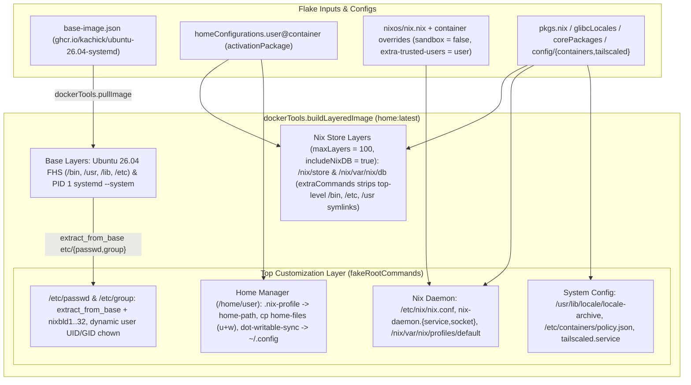
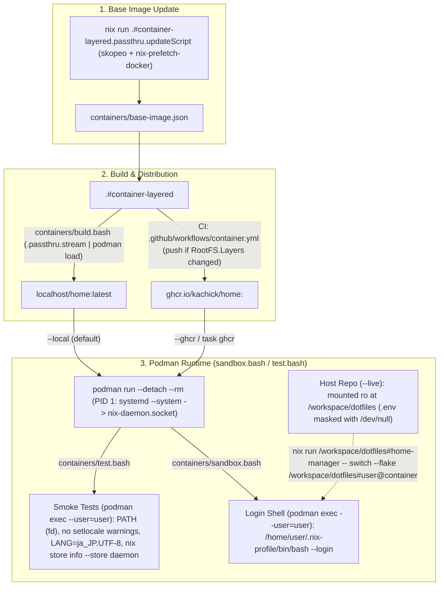

# Containers

Base image (`ghcr.io/kachick/ubuntu-26.04-systemd`) is maintained in [kachick/containers](https://github.com/kachick/containers).
[layered-image.nix](./layered-image.nix) layers the Nix store closure and Home Manager configuration (`user@container`) on top of that Ubuntu + systemd base image using `dockerTools.buildLayeredImage`.

## Image Composition (`layered-image.nix`)



## Build, Distribution & Runtime Workflow



## Build and test locally

```bash
# Update base image digest and hash in base-image.json
nix run .#container-layered.passthru.updateScript

# Build and stream-load into podman
task build-container

# Or build the compressed tarball and load with progress
nix build .#container-layered
pv result | podman load

# Run smoke tests
task test-container

# Start an interactive login shell
task sandbox

# Start with the current repo mounted read-only at /workspace/dotfiles
./containers/sandbox.bash --live
```

Inside a `--live` shell, apply working tree changes without rebuilding the image:

```bash
nix run /workspace/dotfiles#home-manager -- switch --flake /workspace/dotfiles#user@container
```
