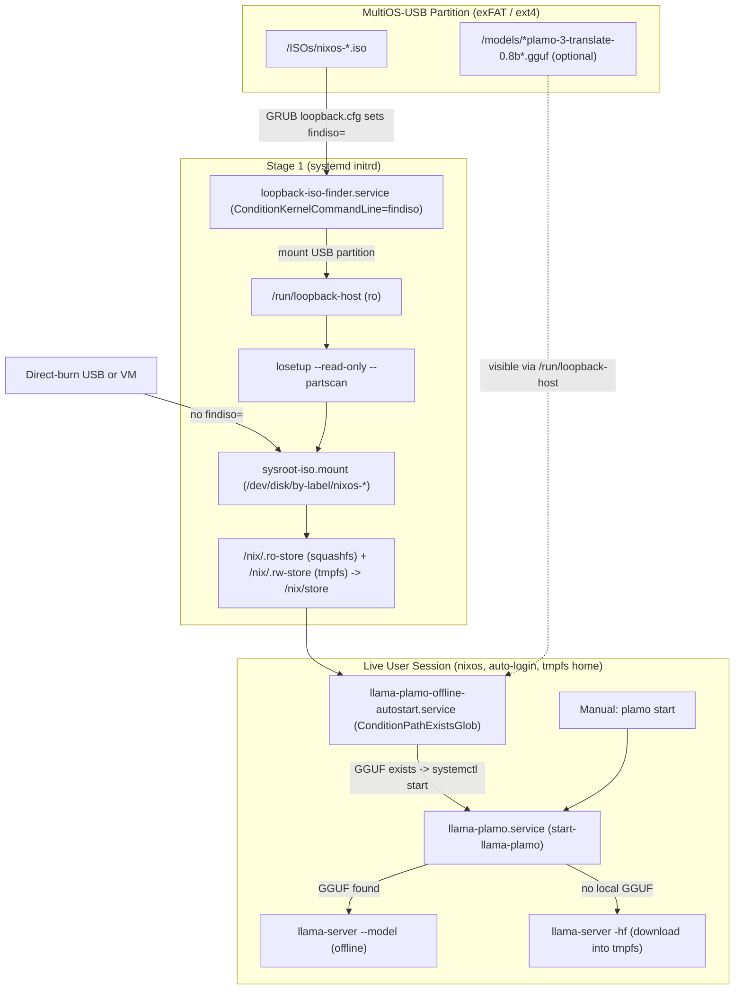

# Recovery Live ISO (`installer`)

Volatile NixOS desktop Live ISO for recovery and installation. Built in CI without unfree AI model weights so the ISO stays safe to distribute publicly while still supporting offline translation from a MultiOS-USB data partition.

## MultiOS-USB Setup

```bash
# List removable USB devices
sudo multios-usb --devices

# Initialize a USB drive once (erases existing data on the drive)
sudo multios-usb /dev/sdX

# Copy the CI-built ISO and optional local PLaMo GGUF onto the mounted MultiOS-USB partition
USB_DIR="/run/media/${USER}/MultiOS-USB"
cp ~/Downloads/nixos-*.iso "${USB_DIR}/ISOs/"
mkdir --parents "${USB_DIR}/models"
find ~/.cache -name '*plamo-3-translate-0.8b*.gguf' -exec cp --dereference {} "${USB_DIR}/models/" \;
sync

# Build the ISO locally instead of downloading from CI
nix build ".#nixosConfigurations.installer.config.system.build.isoImage" --show-trace
```

## Boot and Offline Translation Flow



- All writes under `/` and `/home/nixos` live in RAM (`tmpfs`) and vanish on shutdown.
- `loopback-iso-finder.service` is skipped on direct-burn USBs and VMs because `findiso` is absent from `/proc/cmdline`.
- Without a local GGUF on `/run/loopback-host`, `llama-plamo` does not auto-start to avoid filling `tmpfs`, while manual `plamo start` falls back to `-hf`.
