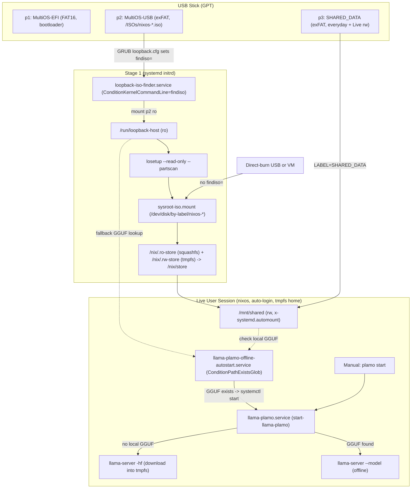

# Recovery Live ISO (`installer`)

Volatile NixOS desktop Live ISO for recovery and installation. Built in CI without unfree AI model weights so the ISO stays safe to distribute publicly while still supporting offline translation and shared storage from a MultiOS-USB drive.

## MultiOS-USB Setup

```bash
# List removable USB devices
sudo multios-usb --devices

# Initialize a USB drive with a 16G MultiOS-USB partition for ISOs (erases existing data)
sudo multios-usb /dev/sdX 16G

# Create a 3rd partition (SHARED_DATA) from the remaining space for everyday + Live rw use
sudo sgdisk -n 3:0:0 -t 3:0700 -c 3:"Shared Data" /dev/sdX
sudo partprobe /dev/sdX
sudo mkfs.exfat -n SHARED_DATA /dev/sdX3

# Copy the CI-built ISO onto MultiOS-USB and optional local PLaMo GGUF onto SHARED_DATA
cp ~/Downloads/nixos-*.iso "/run/media/${USER}/MultiOS-USB/ISOs/"
find ~/.cache -name '*plamo-3-translate-0.8b*.gguf' \
	-exec cp --dereference {} "/run/media/${USER}/SHARED_DATA/" \;
sync

# Build the ISO locally instead of downloading from CI
nix build ".#nixosConfigurations.installer.config.system.build.isoImage" --show-trace
```

## Boot and Storage Flow



- All writes under `/` and `/home/nixos` live in RAM (`tmpfs`) and vanish on shutdown.
- `MultiOS-USB` stays read-only at `/run/loopback-host` during Live boots to protect the mounted ISO, while `SHARED_DATA` mounts read-write at `/mnt/shared` for general files and local GGUF models.
- `loopback-iso-finder.service` is skipped on direct-burn USBs and VMs because `findiso` is absent from `/proc/cmdline`.
- Without a local GGUF on `/mnt/shared` or `/run/loopback-host`, `llama-plamo` does not auto-start to avoid filling `tmpfs`, while manual `plamo start` falls back to `-hf`.
