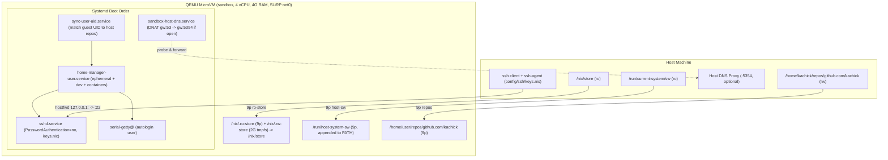
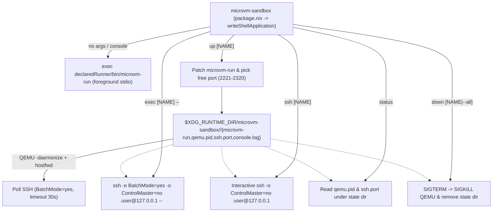

# MicroVM Sandbox

Lightweight, volatile NixOS microvm built with [microvm.nix](https://github.com/microvm-nix/microvm.nix) and QEMU.

```bash
# Foreground serial console (autologin as user)
nix run .#microvm-sandbox

# Background instances over SSH (pubkey auth via config/ssh/keys.nix)
nix run .#microvm-sandbox -- up test-1
nix run .#microvm-sandbox -- status
nix run .#microvm-sandbox -- exec test-1 -- hostname
nix run .#microvm-sandbox -- ssh test-1
nix run .#microvm-sandbox -- down test-1
nix run .#microvm-sandbox -- down --all
```

- `/home/user/repos/github.com/kachick` is shared read-write with the host.
- `/nix/store` uses a volatile `tmpfs` overlay (`2G`) and resets on shutdown.
- Background SSH logins require a local private key or `ssh-agent` matching `config/ssh/keys.nix`.

## Architecture (`default.nix`)



## CLI & Lifecycle (`microvm-sandbox.bash`)



## Why not nixos-shell?

Evaluated [nixos-shell](https://github.com/Mic92/nixos-shell) as of 2026-11. Revisit if these points change:

- Broken on `nixos-unstable`: `2.2.0` in nixpkgs references removed `boot.initrd.systemd.enable`, and `main` fails to replace `--cache=always` in `run-nixos-vm` after the `run-virtiofsd-qemu` change.
- Depends directly on `qemu-vm.nix` runner script text, so upstream `nixpkgs` updates break it easily.
- Defaults to root autologin, full `$HOME` mount, and `.qcow2` disk files in the working directory instead of a volatile, scoped sandbox.
- Existing host configs (such as `moss`) hit host-specific checks like `zswap` without extra overrides.
