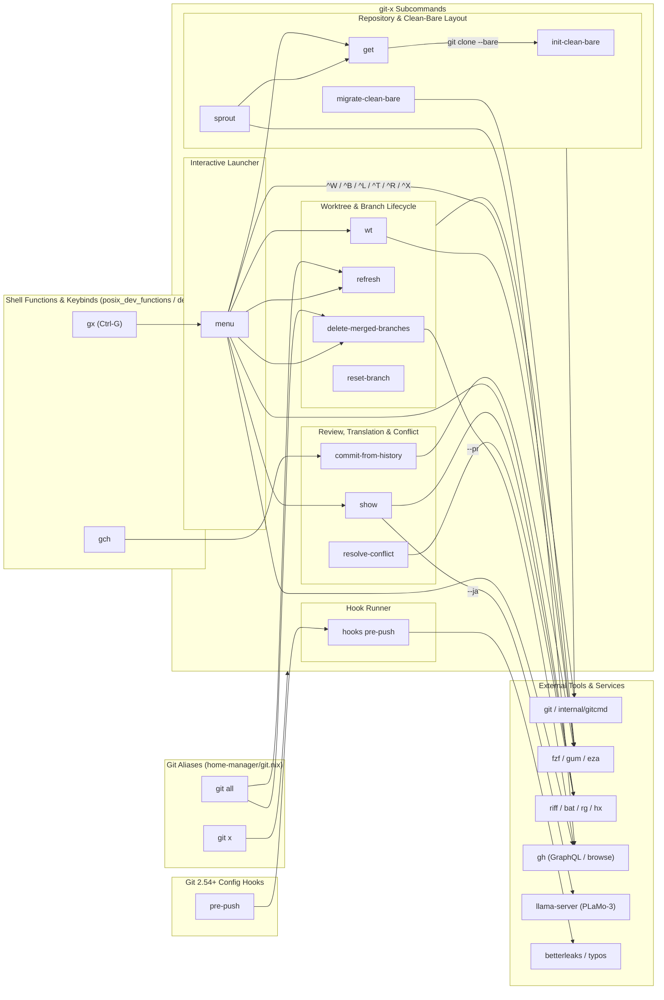
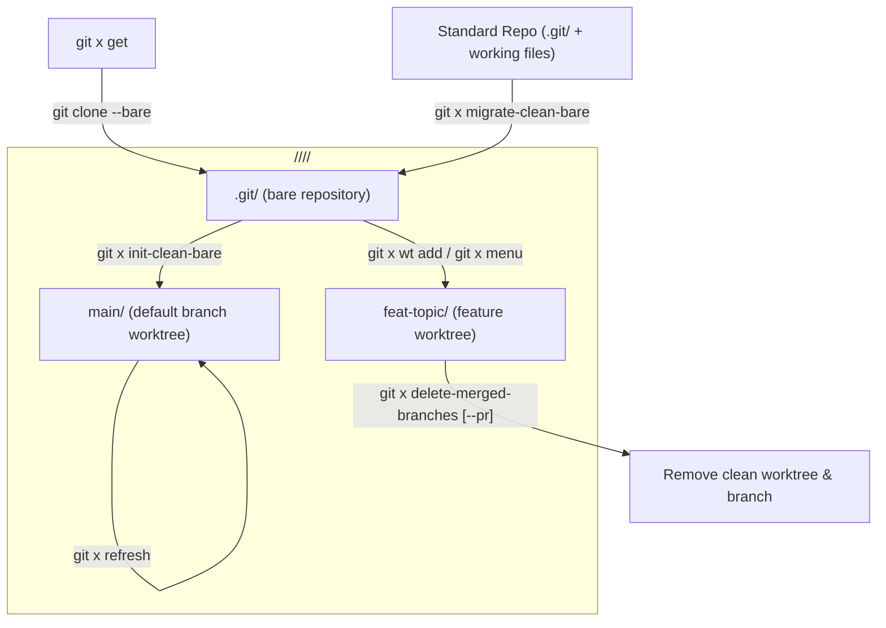
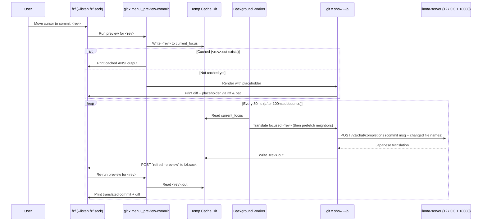

# git-x

Unified CLI combining local Git and GitHub helper subcommands.

## Architecture & Entry Points



## Subcommands

| Category            | Subcommand                                                         | Caller / Alias                            | Purpose                                                                                                        |
| ------------------- | ------------------------------------------------------------------ | ----------------------------------------- | -------------------------------------------------------------------------------------------------------------- |
| Launcher            | `menu [--mode <view>] [query]`                                     | `gx`, `Ctrl-G`                            | Single-entry `fzf`/`gum` launcher for commits, worktrees, branches, tags, and repos (`Alt-J` ja, `Alt-F` zoom) |
| Repository & Layout | `get [--trust] <spec>`                                             | `git x get`, `git x menu`, `git x sprout` | Clone into `<root>/<host>/<owner>/<repo>/.git` and initialize the default worktree                             |
| Repository & Layout | `sprout <repo>`                                                    | `git x sprout`                            | Create a private template repo on GitHub, clone in clean-bare layout, and enable auto-merge                    |
| Repository & Layout | `init-clean-bare [--trust] <dir>`                                  | `git x init-clean-bare`, `git x get`      | Configure origin fetch refspec and create the default branch worktree                                          |
| Repository & Layout | `migrate-clean-bare [--dry-run] [--trust] [--interactive] [<dir>]` | `git x migrate-clean-bare`                | Convert a standard Git repository into clean-bare layout in place                                              |
| Worktree & Branch   | `wt [list\|add\|pr\|promote\|path]`                                | `git x wt`, `git x menu`                  | Manage flat depth-1 worktrees (`/` in branch names replaced with `-`)                                          |
| Worktree & Branch   | `refresh`                                                          | `git x refresh`, `git all`                | Update `upstream` or `origin` and fast-forward the default branch                                              |
| Worktree & Branch   | `delete-merged-branches [--dry-run] [--pr]`                        | `git x delete-merged-branches`, `git all` | Remove merged local branches and clean worktrees (`--pr` checks merged GitHub PRs)                             |
| Worktree & Branch   | `reset-branch [--remote <name>] [--dry-run] [branch]`              | `git x reset-branch`                      | Rename local branch to `backup-<branch>-<uuid>` and recreate it from remote                                    |
| Log & Review        | `show [--ja] [git-show-args...]`                                   | `git x show`, `git x menu`                | Run `git show` through `riff` (`--ja` injects Japanese translation via local `llama-server`)                   |
| Log & Review        | `resolve-conflict`                                                 | `git x resolve-conflict`                  | Find `<<<<<< HEAD` markers in unmerged files with `rg` and open them in Helix (`hx --hsplit`)                  |
| Log & Review        | `commit-from-history`                                              | `gch`                                     | Pick a shell history line via `fzf` and commit all changes with `` `<command>` ``                              |
| Hooks               | `hooks pre-push <subcommand>`                                      | Git `hook.*` config                       | Run `betterleaks`, `typos-commits`, or `typos-branch` before pushing                                           |
| Shell               | `completion <bash\|zsh>`                                           | Nix `installShellCompletion` (`git-x`)    | Print shell completion wrappers backed by `git-x __complete`                                                   |

## Clean-Bare Worktree Layout & Lifecycle

`git-x` organizes repositories in a clean-bare layout where `.git` holds the bare repository and every branch lives in a flat sibling directory at depth 1 (`feat/foo` becomes `feat-foo`).

Commands that return a directory path (`menu`, `get`, `sprout`, `init-clean-bare`, `migrate-clean-bare`, `wt add`, `wt pr`, `wt promote`, `wt path`) send all Git progress and TUI prompts to `stderr` so `stdout` only prints the target path for shell `cd` wrappers.



## `git x menu` Commits View & Asynchronous Translation Flow

When `--mode` is omitted, `git x menu` (`Ctrl-G` / `gx`) picks the initial view from the current directory: `repos` outside a Git repository, `commits` inside a worktree, and `worktrees` at a clean-bare repository root.

In the Commits view, Japanese translation defaults to on when the effective locale (`LC_ALL`, `LC_MESSAGES`, `LANG`) starts with `ja` and off otherwise (set `LANG=C` for a lightweight plain session). Pressing `Alt-J` toggles Japanese translation on or off inside the same `fzf` session without losing the cursor position or query, pressing `Alt-F` toggles a larger preview pane (`down,80%`) while keeping the `fzf` list visible, and pressing `Enter` displays the selected commit details. When the preview pane is wide enough (100+ columns), the original commit message and Japanese translation are shown side by side above the diff. While translation is on, a background worker watches the focused commit in `fzf`, translates it first, prefetches adjacent commits, and tells `fzf` to refresh its preview over a Unix socket. Translated commit messages are cached under `$XDG_CACHE_HOME/git-x/translations/` (shared with `git x show --ja`), so previously translated commits render right away across sessions.



## `git x hooks pre-push`

A helper command for Git 2.54+ config based hooks (`git hook`). It checks git commits and branch names before pushing.

### Subcommands

- `betterleaks`: Scan commit logs and diffs for secrets.
- `typos-commits`: Scan commit logs and diffs for typos.
- `typos-branch`: Check branch names for typos.

### Why Not Skip Single Commits in the Hook

This hook does not support skipping a single commit by revision flag or environment variable:

- Parsing revisions and excluding commits inside the hook adds complexity. Bugs in revision filtering or tool options (such as `--no-walk`) could let secrets pass quietly.
- Tools like `git log --no-walk` do not show diffs for merge commits by default. Handling merge commits in custom hook code is easy to get wrong.

### How to Skip a Hook for a Single Push

Hooks are split in Git config so each check can be toggled without disabling all hooks:

```console
# Skip typo checks for one push (betterleaks still runs)
git -c hook.pre-push-no-typos-in-commits.enabled=false push
```

### How to Skip a Hook for Only One Commit

If you have multiple commits to push (e.g., `A -> B -> C`) and only commit `B` has a false positive:
Push commits one by one with Git refspecs:

```console
# 1. Push commit A with all checks
git push origin <commit-A>:my-branch

# 2. Push commit B while skipping typo checks (betterleaks still checks B)
git -c hook.pre-push-no-typos-in-commits.enabled=false push origin <commit-B>:my-branch

# 3. Push remaining commit C with all checks
git push origin HEAD:my-branch
```

This uses standard Git features without risk of silent check failures.
