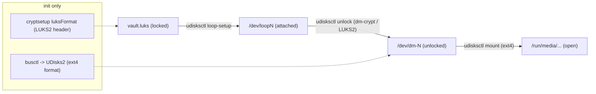

# luks-vault (`vault`)

Mini-TUI and CLI wrapper around Linux's built-in LUKS2, `udisksctl`, and `ext4` to create, open, and close encrypted `.luks` container files without third-party FUSE encryption tools.

## Motivation

Live USB sessions share a writable exFAT partition (`/mnt/shared` on Live ISO, `/run/media/$USER/SHARED_DATA` on desktop hosts) that is unencrypted. Storing sensitive notes, recovery keys, or Wi-Fi credentials there needs an encrypted container that:

- Works identically across the Live ISO and regular Linux hosts without depending on OS user accounts or login passwords.
- Uses only OS-standard primitives (`dm-crypt` / LUKS2 + `ext4` + `udisks2`), so containers stay readable on any Linux system even without this wrapper and can later enroll hardware tokens via `systemd-cryptenroll`.
- Opens and closes without `sudo` via `udisksctl`, showing up in Nautilus automatically.

## Usage

```bash
# Open interactive fzf + gum menu (scans /mnt/shared, /run/media/$USER/*, $VAULT_DIR, and CWD)
vault

# Create a new 512 MiB LUKS2 + ext4 container (defaults to /mnt/shared/vault.luks when writable)
vault init --size 512M

# Unlock and mount without sudo
vault open
vault open /path/to/custom.luks

# Unmount, lock, and detach loop device
vault close
vault close --all

# Print current container states
vault status
```

## How it works

`vault open` moves a container from left to right. `vault close` reverses the steps.



- `udisks2` (`udisksctl`): System storage service that lets normal users attach, unlock, and mount volumes without `sudo`, and makes them show up in Nautilus.
- Loop device (`/dev/loopN`, `losetup`): Linux kernel feature that treats a regular `.luks` file like a disk. `losetup` checks active file-to-loop links.
- `dm-crypt` / LUKS2 (`cryptsetup`): Linux kernel disk encryption (`dm-crypt`) with the standard LUKS2 header format. Unlocking creates a decrypted virtual disk (`/dev/dm-N`). `cryptsetup` is used only to initialize headers (`luksFormat`) and inspect them (`luksDump`).
- `ext4` / `busctl`: Standard Linux filesystem created inside `/dev/dm-N`. Because `udisksctl` has no format subcommand, `vault init` calls UDisks2's `Block.Format` D-Bus method through `busctl`.
- `lsblk`: Reads the `/dev/loopN` -> `/dev/dm-N` -> mountpoint tree to detect container state (`locked`, `attached`, `unlocked`, or `open`).
