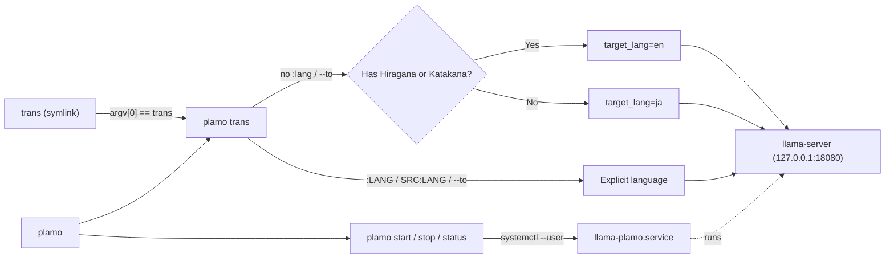

# plamo

Local PLaMo-3-Translate CLI and `llama-plamo` service controller.

## Architecture



## Quick Examples

```console
# Auto-detect (English -> Japanese, Japanese -> English)
trans "Hello, world!"
trans "こんにちは"

# Explicit target or source:target
trans :en "おはようございます"
trans en:ja --form polite "Good morning"

# Pipe input
echo "Hello, world!" | trans

# Service control and full options
plamo status
plamo start
trans --help
```
